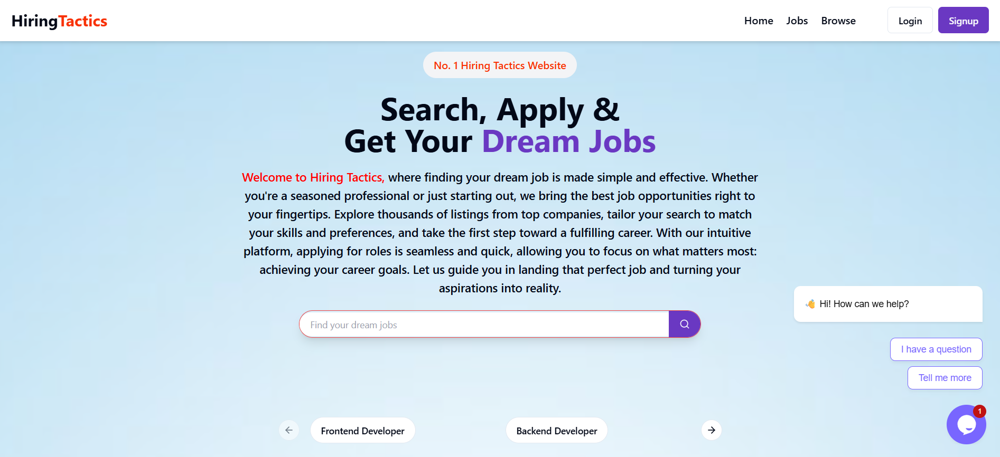
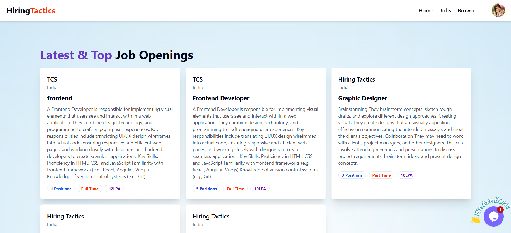
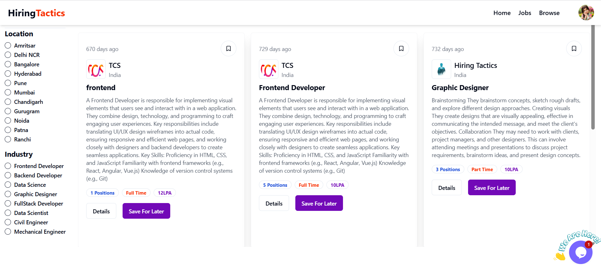
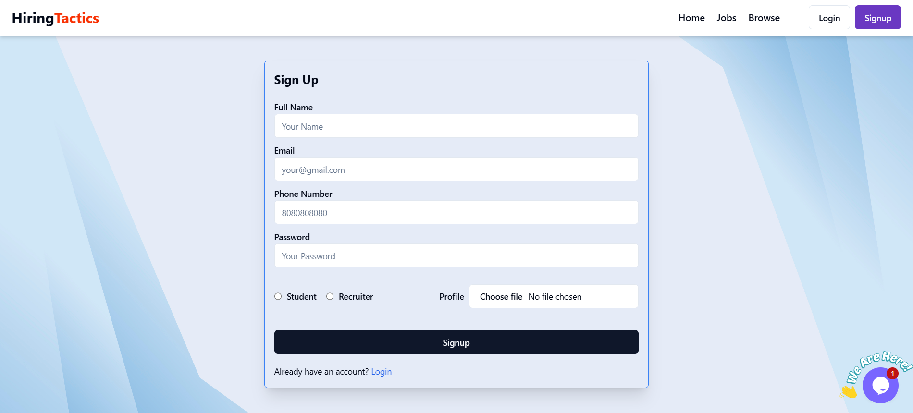
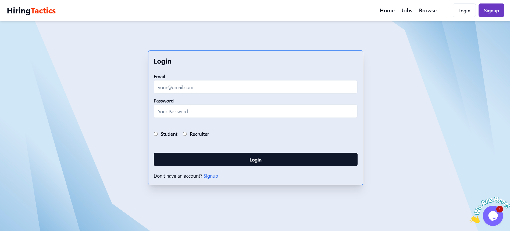
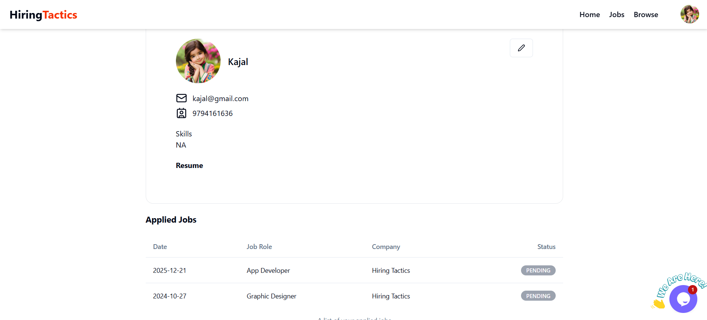
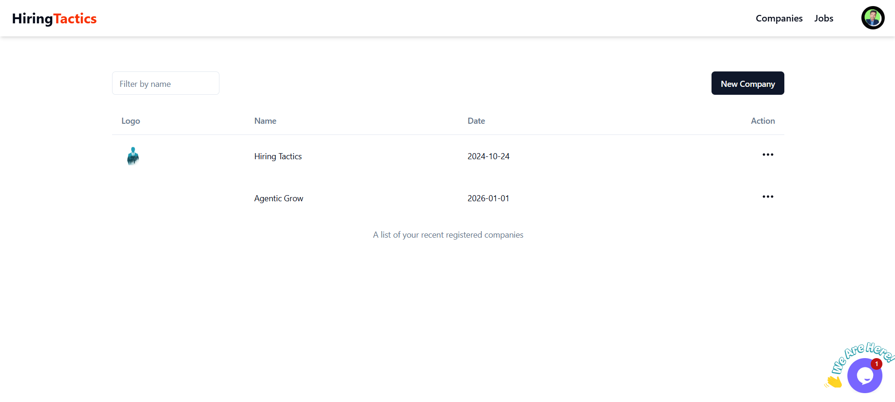
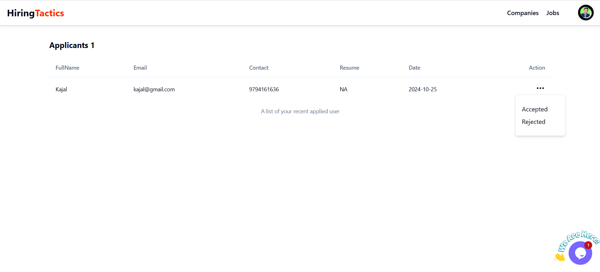

# 💼 HiringTactics – Job Portal

A full-stack job portal web application that connects job seekers with employment opportunities and enables recruiters to manage job postings and applicants. HiringTactics provides job discovery, advanced filtering, job applications, applicant tracking, and recruiter dashboard functionality through an intuitive interface.

🌐 **Live Demo:** [HiringTactics](https://hiring-tactics-1.onrender.com/)

## 🚀 Tech Stack

- **Frontend:** React.js, JavaScript (ES6+)
- **Styling:** Tailwind CSS
- **Backend:** Node.js, Express.js
- **Database:** MongoDB
- **Authentication:** JSON Web Tokens (JWT)
- **Authorization:** Role-Based Access Control (RBAC)
- **API Architecture:** RESTful APIs
- **Deployment:** Render

## ✨ Features

### 👨‍💻 Job Seeker

- **User Authentication** — Register and log in to access personalized features.
- **Browse Jobs** — Explore job opportunities across different companies and industries.
- **Search Jobs** — Find relevant openings based on job titles and keywords.
- **Advanced Filtering** — Filter job listings by location and industry.
- **Job Details** — View company information, job descriptions, employment types, salary packages, and available positions.
- **Apply for Jobs** — Submit applications for suitable opportunities.
- **Save Jobs** — Bookmark job listings to revisit them later.
- **Profile Management** — Maintain personal information and professional details.
- **Application Tracking** — Review applied jobs and monitor application statuses, including Pending, Accepted, and Rejected.

### 🏢 Recruiter Dashboard

- **Job Management** — Manage job postings and recruitment activities.
- **Applicant Management** — View applicants and their submitted information.
- **Applicant Details** — Review candidate names, email addresses, contact numbers, resumes, and application dates.
- **Application Status Management** — Accept or reject applicants through the recruiter interface.
- **Recruitment Workflow** — Track applications and manage candidate selection.

### 🔐 Security and Access Control

- JWT-based authentication for protected routes.
- Role-Based Access Control (RBAC) for job seeker and recruiter functionality.
- Role-specific access to relevant application features.
- Authenticated workflows for managing user and recruitment data.

## 📸 Screenshots

### 🏠 Home Page

The landing page introduces HiringTactics and provides quick access to job search and popular job categories.



### 💼 Latest Job Openings

Browse available jobs with company information, job descriptions, employment types, salary details, and position counts.



### 🔎 Browse Jobs and Filters

Discover relevant opportunities using location and industry filters, with options to view job details and save jobs for later.



📝 Sign Up Page

New users can register by entering their name, email, phone number, password, account role, and profile document.



🔐 Login Page

Users can securely log in as a student or recruiter to access role-specific features.



### 👤 Job Seeker Profile and Applications

View profile information and review previously submitted applications along with their current statuses.



🏢 Recruiter Companies Dashboard

Recruiters can browse registered companies, filter companies by name, register a new company, and access company actions.



### 🏢 Recruiter Applicant Management

Recruiters can review applicants and update application decisions using the available action menu.



> **Note:** Add your screenshots to a `screenshots` folder in the repository and ensure the filenames match the paths above. Replace these paths if your images are stored elsewhere.

## 🛠️ Getting Started

Follow these steps to run the project locally.

### Prerequisites

Install the following before starting:

- [Node.js](https://nodejs.org/)
- npm
- [MongoDB](https://www.mongodb.com/)
- Git

### 1. Clone the Repository

```bash
git clone https://github.com/imsalimansari/HiringTactics.git
cd HiringTactics
```

> Replace the repository URL with your actual GitHub repository URL if it differs.

### 2. Install Dependencies

If the project has separate frontend and backend directories, install dependencies in each directory.

**Frontend:**

```bash
cd client
npm install
```

**Backend:** Open another terminal and navigate to the backend directory.

```bash
cd server
npm install
```

> Adjust `client` and `server` to match your actual folder structure.

### 3. Configure Environment Variables

Create a `.env` file in the backend directory and configure the variables required by your application.

```env
PORT=5000
MONGO_URI=your_mongodb_connection_string
SECRET_KEY=your_jwt_secret
```

Use the exact environment variable names expected by your backend code. Never commit real credentials or secrets to GitHub.

### 4. Start the Backend Server

From the backend directory, run the development script configured in `package.json`.

```bash
npm run dev
```

If your project does not define a `dev` script, use the script available in its `package.json`.

### 5. Start the Frontend

From the frontend directory, run:

```bash
npm run dev
```

Open the local URL displayed in the terminal to access the application.

## 📁 Project Structure

The following is an example structure. Adapt it to match your actual repository.

```text
HiringTactics/
├── client/
│   ├── public/
│   ├── src/
│   │   ├── components/
│   │   ├── pages/
│   │   ├── hooks/
│   │   ├── redux/
│   │   ├── utils/
│   │   └── App.jsx
│   └── package.json
│
├── server/
│   ├── controllers/
│   ├── middleware/
│   ├── models/
│   ├── routes/
│   ├── utils/
│   ├── index.js
│   └── package.json
│
├── screenshots/
├── .gitignore
└── README.md
```

## 🏗️ Build for Production

To create an optimized frontend production build, navigate to the frontend directory and run:

```bash
npm run build
```

For a local preview of the production build:

```bash
npm run preview
```

## 📤 Deployment

The application can be deployed using platforms such as:

- **[Render](https://render.com/)** — Host the backend and, if configured, the frontend.
- **[Vercel](https://vercel.com/)** — Deploy the React frontend.
- **[MongoDB Atlas](https://www.mongodb.com/products/platform/atlas-database)** — Host the MongoDB database.

Ensure that the production environment variables, database connection, frontend API URL, and CORS configuration are correctly set before deployment.

## 🎯 Project Objectives

- Build a full-stack job portal using the MERN stack.
- Implement authentication and role-based authorization.
- Develop RESTful APIs for job and application workflows.
- Create job search and filtering functionality.
- Implement recruiter-side applicant management.
- Practice database operations, API integration, and full-stack application development.

## 🔮 Future Enhancements

- Resume upload and preview functionality.
- Email notifications for application status updates.
- Advanced job recommendations based on skills and preferences.
- Recruiter analytics and recruitment statistics.
- Improved search with additional filters and pagination.

## 📬 Contact

**Salim Ansari**

- 🌐 **Portfolio:** [imsalimansari.vercel.app](https://imsalimansari.vercel.app/)
- 💻 **GitHub:** [imsalimansari](https://github.com/imsalimansari)
- 🔗 **LinkedIn:** [Salim Ansari](https://www.linkedin.com/in/imsalimansari/)
- 📧 **Email:** [salimansari7644@gmail.com](mailto:salimansari7644@gmail.com)

---

**Built with ❤️ by Salim Ansari using the MERN stack.**